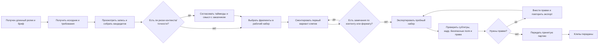

# Лабораторная работа № 3. Процесс как он есть

## Тема
Нарезка длинного видео на короткие клипы.

## Выбранный процесс
Выбран повторяющийся процесс в системе: подготовка партии коротких клипов из уже записанного длинного видео. Он задаёт основной ритм работы и содержит наиболее заметные отклонения от регламента.

## 1. Официальный регламент (как должно быть)
Официальная логика процесса выглядит так:

1. Получить исходник и бриф.
2. Просмотреть запись и выбрать потенциальные фрагменты.
3. Согласовать таймкоды и смысл с заказчиком.
4. Смонтировать клипы, оформить титры и кадрирование.
5. Проверить технические требования и права.
6. Экспортировать финальную партию и передать файлы.

Это описание удобно для планирования, но оно слишком идеализировано и не показывает, где реально возникают возвраты и задержки.

## 2. Процесс as-is (реальный поток)

## 3. Что в реальности отличается от регламента

### 3.1. Согласование не одноразовое, а многократное
В идеале выбирают фрагменты, монтируют и только потом согласуют. В реальности редактор сначала отмечает таймкоды, потом возвращается к исходнику, чтобы проверить смысл и контекст, а затем уже согласовывает выбор с заказчиком. То есть промежуточный цикл повторяется до тех пор, пока фрагмент не выглядит достоверно и не нарушает замысел записи.

### 3.2. Формат и оформление часто выясняются слишком поздно
По регламенту технические требования вроде формата кадра, размер субтитров и безопасные поля должны быть известны заранее. На практике они часто всплывают только на этапе первого экспорта, когда материал уже смонтирован. Тогда исполняется повторный круг: правки -> экспорт -> проверка -> ещё правки.

### 3.3. Обратная связь от заказчика обычно неадресная
Комментарии вроде «сделать динамичнее» кажутся простыми, но они не содержат точный таймкод, конкретный недостаток и критерий качества. Для редактора это значит дополнительный просмотр и принятие решения без чёткой инструкции, то есть фактически возврат к этапу анализа и повторного монтажа.

### 3.4. Люди не отклоняются от регламента от лени
Они делают так, потому что реальный процесс наполнен неопределённостью:
- требования к контенту появляются по мере работы;
- контекст реплики нельзя понять без возвращения к исходному видео;
- формат площадки и технические ограничения могут не быть согласованы вовремя;
- заказчик оценивает результат по итоговому впечатлению, а не по заранее зафиксированным критериям.

## 4. Где чаще всего происходит застревание
Самая проблемная точка — после первого экспорта, когда уже есть черновой монтаж, но ещё не согласованы все требования к формату и качеству. На этом этапе обычно возникают три повторяющиеся задержки:

- повторный поиск и проверка контекста в исходном видео;
- повторный экспорт после исправления титров, кадрирования и полей;
- переработка замечаний заказчика, которые не содержат конкретных таймкодов и критериев.

Именно эта зона делает процесс «не линейным» и заставляет людей уходить от идеального регламента.

## 5. Почему так происходит
Причина в том, что регламент описывает систему как стабильную и заранее заданную, а реальность — как адаптивную и неоднозначную. В процессе нарезки данные уточняются по ходу дела: позже выясняется, в каком контексте реплика будет понятна; позже узнают ограничения площадки; позже приходит замечание, которое требует пересмотра смысла или темпа. Поэтому рабочий процесс строится не по прямой линии, а через циклы проверки и возврата.

## 6. Вывод
Модель as-is показывает, что официальный регламент не отражает реального хода работы: в жизни поиск фрагментов, согласование, проверка формата и правки идут в несколько циклов. Это не случайная ошибка, а следствие того, что инструкция не учитывает реальную неопределенность входной информации и не задаёт достаточно точные критерии обратной связи. Именно поэтому реальный процесс выглядит как повторяющаяся последовательность «смонтировать → проверить → исправить → экспортировать», а не как один прямой маршрут от исходника до передачи файлов.
